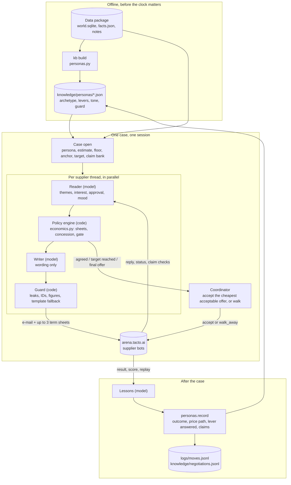

# Codacabana: EHL Grand Finale

Team Codacabana at the European Hackathon League Grand Finale, Munich, 10 to 11 October 2026.
Challenge: the **Tacto Negotiation Arena** (`docs/challenge.md`): an AI buyer agent for Hollerau
Pumpenwerke that negotiates by e-mail with supplier bots and is scored on the total cost of the deal.

## Setup

```sh
git config core.hooksPath .githooks   # secret scan, no pushes to main, Entire hooks
uv sync --all-groups                  # Python 3.12, the arena kit (editable), anthropic, pytest, ruff
cp .env.example .env                  # ARENA_API_KEY, ANTHROPIC_API_KEY (never commit it)
uv run negotiator kb build            # supplier personas from the data package -> knowledge/personas/
```

The arena kit lives in `negotiation-agent/negotiation-arena-kit/` (brief, API docs, data package,
starter kit); `uv run arena ...` still works for its commands (`arena me`, `arena cases`, `arena data`).

## Run

```sh
uv run negotiator play case:D01 -v                 # one case (sandbox: no quota)
uv run negotiator play case:P01 -v                 # a hosted practice case (counts against the 200 a day)
uv run negotiator run --set practice --parallel 8  # every hosted practice case
uv run negotiator run --set final --parallel 10    # the Live Final: start before 12:00 and leave it running
uv run negotiator kb show sup:70110                # a supplier's persona
```

Without `ANTHROPIC_API_KEY` (or with `--no-llm`) the agent still plays: every e-mail comes from a
template and the supplier's reply is read by keywords. The model only improves the wording and the
reading; it never sets a term.

Environment variables (`.env.example`): `ARENA_URL`, `ARENA_API_KEY`, `ARENA_DATA`,
`ANTHROPIC_API_KEY`, `LLM_MODEL` (default `claude-opus-5-5`), `LLM_EFFORT` (default `low`).

## Status

Done on this branch:

- The organisers' kit (brief, API docs, data package v1, starter kit) checked in under `negotiation-agent/`.
- `negotiator/`: a first full agent. Code sets every term and every binding decision; the model reads
  replies and words e-mails; every e-mail passes a guard; a deterministic template replaces the model
  when it is slow, down or unusable.
- One negotiator per supplier thread, in parallel, with a coordinator that closes on the cheapest
  acceptable standing offer, so RFQ threads each answer inside their own 60-second clock.
- `knowledge/personas/`: 46 supplier personas built from the data (archetype with evidence, levers,
  tone, relationship guard), updated after every real negotiation.
- A claim bank whose figures are computed exactly as the arena checks them.
- Tests (unit plus one case end to end against the local simulator), lint and CI config.
- Verified against arena-sim: a price increase, a two-supplier RFQ and a renewal all close with a deal.

Not yet: a run against the hosted arena (needs the team key), the model path end to end (needs an
Anthropic key), reading a supplier's cost-breakdown spreadsheet into our estimate, and the model digest
of each supplier's notes (`kb build --llm`).

## Architecture



## How the agent works

Principle: **code owns every number and every binding decision; the model reads people and writes
e-mails.** The score is the total cost C, so the agent optimises C, never the price alone.

| Module | Owns |
|---|---|
| `negotiator/personas.py` | the supplier knowledge base: archetype, levers, tone, relationship guard; updated after every case |
| `negotiator/claims.py` | the claim bank: data arguments with the figure computed exactly as the arena checks it |
| `negotiator/economics.py` | C of every package, floor and anchor, probe sheets, concession schedule, the accept gate |
| `negotiator/agent.py` | one agent per case: read reply, decide the move per thread, write, learn |
| `negotiator/llm.py` | the reader (reply to signals, JSON) and the writer (brief to e-mail), hard timeouts, deterministic fallback |
| `negotiator/guard.py` | leak filter, unknown IDs, foreign figures; the template e-mail |
| `negotiator/runner.py` | one negotiator per supplier thread in parallel, closing by a coordinator; practice and wave runners |

**A case, step by step.** At open: load each supplier's persona (or build one on the spot), estimate
its full cost from should-cost data, set a floor (full cost plus the margin we leave it), an anchor
and a target C, and build the claim bank. Round 1 sends up to three sheets: the anchor with our best
terms, plus variants that trade price against the lever the persona values (faster payment for a
cash-short shop, a longer contract for a family firm), each at the same C for us. Every reply is read
for cost-driver themes, interest, approval hints and mood; the sheet the supplier answered pins that
lever. We concede only after the supplier moved, in falling steps of the remaining gap, and accept
when C reaches the target, on `agreed`, or on a `final_offer` we should not push.

**Relationships.** Suppliers in strategic categories (castings, seals, electrical), A suppliers and
single sources are tiered `strategic` or `important`. For them the floor keeps a higher margin, the
agent pushes the price in at most two or three rounds, never pushes after a final offer, never
threatens, never cites rival quotes to a strategic supplier, and never walks away from a bottleneck.
In `stabilise` and `secure_supply` cases the arena's own relationship charge is priced into every C.

**Learning.** After each case the persona records the outcome, the supplier's price path, which
lever it answered, how our claims checked out, approval signals and mood, plus three model-written
lessons; the archetype, lever order and guard are re-derived from data signals plus this history.
`knowledge/negotiations.jsonl` is the append-only log; `logs/moves.jsonl` holds every move with its
C and latency.

## Develop

```sh
uv run pytest -q          # unit tests plus one case end to end against arena-sim (no network, no model)
uv run ruff check . && uv run ruff format .
```
