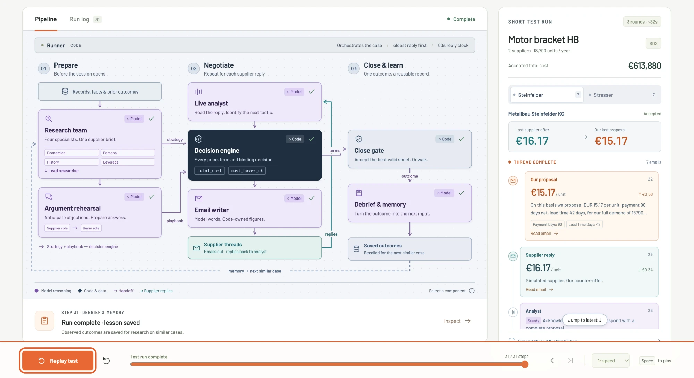

# Codacabana: Tacto Negotiation Arena

An AI buyer that negotiates by e-mail with supplier bots and closes the deal with the lowest
total cost, or walks away.

Built by Team Codacabana at the European Hackathon League Grand Finale, Munich, 10 to 11 October
2026, on the Tacto track. The buyer works for Hollerau Pumpenwerke, a fictional pump maker. Each
case is scored on how much of the possible saving it captures:
`(C_open - C_deal) / (C_open - C_best)`. Brief: [docs/challenge.md](docs/challenge.md).



*The pipeline monitor in [`pitch/`](pitch/README.md) replaying a simulated case, with the live
supplier thread on the right.*

## How it works

**Code owns every binding number; the model owns words.** Prices, term sheets, accepts and
walk-aways are computed and checked with the arena's exact cost function (`total_cost`,
`must_haves_ok`). Models read, argue and write, but cannot change a figure.

| Stage | What happens | Where |
|---|---|---|
| **Prepare** | Four specialist researchers (economics, persona, history, leverage) and a lead build one supplier brief. A supplier and a buyer subagent then rehearse the arguments into a playbook. | [`research.py`](buyer/research.py), [`rehearsal.py`](buyer/rehearsal.py) |
| **Negotiate** | For each supplier reply: the live analyst reads the mood and tactic, the decision engine sets price and terms, the writer turns them into an e-mail with claims cited by data ID. | [`analyst.py`](buyer/analyst.py), [`policy.py`](buyer/policy.py), [`economics.py`](buyer/economics.py), [`claims.py`](buyer/claims.py), [`writer.py`](buyer/writer.py) |
| **Close & learn** | The close gate accepts the cheapest valid standing sheet across suppliers, or walks. A debrief saves the outcome for the next similar case. | [`policy.py`](buyer/policy.py), [`memory.py`](buyer/memory.py) |

The [runner](buyer/runner.py) orchestrates each case: it answers the oldest reply first and
keeps every move inside the arena's 60 second clock, whatever fails. The agent branches on what
the data says about a supplier, never on a case or supplier ID.

Read more:

- [writeup/writeup.pdf](writeup/writeup.pdf): the two-page paper on the approach, with the system diagram
- [docs/architecture.md](docs/architecture.md): the module map of the running system
- [docs/design.md](docs/design.md): what the agent does and why
- [docs/learnings.md](docs/learnings.md): what practice showed, with evidence

## Quick start

Python 3.12 and [uv](https://docs.astral.sh/uv/).

```sh
git config core.hooksPath .githooks   # secret scan, no pushes to main, Entire hooks
uv sync                               # the agent, Tacto's arena kit, pytest, ruff
cp .env.example .env                  # fill in the keys below
uv run arena data                     # data package into data/package
uv run arena me                       # the key works: team and practice quota
```

| Variable | What |
|---|---|
| `ARENA_URL` | `https://arena.tacto.ai` |
| `ARENA_API_KEY` | the team key from https://arena.tacto.ai/apply |
| `ARENA_DATA` | `data/package` |
| `LLM_BASE_URL`, `LLM_MODEL`, `LLM_API_KEY` | the model, any OpenAI-compatible chat completions endpoint; optional `LLM_EFFORT` |

## Run

```sh
uv run buyer play case:D01 -v                     # one sandbox case (free)
uv run buyer run --set practice --parallel 10     # every hosted practice case (counts against the quota)
uv run buyer pull --set practice                  # finished sessions with trace -> logs/sessions/
uv run buyer run --set final --parallel 10 -v     # the Live Final: start before 12:00, leave it running
```

## Pipeline monitor

The screenshot above is a small web app that replays one recorded case step by step: which
component acted, what it decided, and the e-mails that went back and forth.

```sh
cd pitch && npm install && npm run dev
```

It plays a bundled trace from the local simulator, so it needs no API key. Details in
[pitch/README.md](pitch/README.md).

## Develop

Rules for people and coding agents: [AGENTS.md](AGENTS.md).

```sh
uv run pytest -q                 # our agent end to end against the local arena simulator
uv run ruff check . && uv run ruff format --check .
```

## Repo map

| Path | What |
|---|---|
| `buyer/` | the agent |
| `tests/` | end-to-end tests against `arena-sim` |
| `pitch/` | the pipeline monitor |
| `docs/` | brief, API, design, architecture, learnings, submission checklist |
| `writeup/` | the paper (`tectonic writeup/writeup.tex` builds it) |
| `analysis/`, `exports/`, `logs/` | exploration, Saturday's sessions as CSV, traces |
