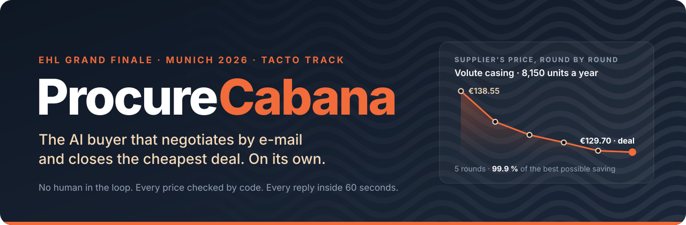
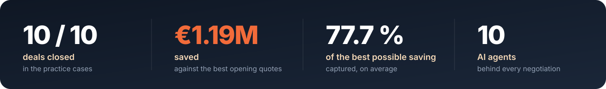

<p align="center">
  
</p>

> **€4.50 a mask. From anyone. In any quantity.**
>
> In 2020 Germany's Federal Ministry of Health promised to buy every FFP2 mask offered to it, at
> one fixed price. It bought 5.7 billion masks for €5.9 billion. About 2 billion were ever handed
> out; most of the rest was destroyed. €2.3 billion is still in court, with a ruling due on
> 15 December 2026.
>
> **Nobody negotiated that price. ProcureCabana would have.**
>
> <sub>Sources: Tagesspiegel, ZDF, Handelsblatt (September 2026); Bund der Steuerzahler.</sub>

<p align="center">
  
</p>


<p align="center"><sub>One negotiation replayed: the agents at work on the left, the e-mail thread with the supplier on the right.</sub></p>

## How it works

1. **Prepare.** Before the first e-mail, a team of AI researchers studies the supplier's history,
   documents and costs, then rehearses the negotiation against a simulated supplier.
2. **Negotiate.** For every reply, an analyst reads the supplier's mood and tactic, code sets the
   price and terms, and a writer turns them into an e-mail that cites hard evidence.
3. **Close and learn.** Code accepts the cheapest valid offer across all suppliers, or walks away,
   and the outcome is remembered for the next similar case.

## Live Final

Second of 22 teams, 4.6 points behind first. Five waves of hidden cases, 29 of 29 deals closed,
€3,065,004 saved. Highest score of any team in waves 1 and 5.

| # | Team | W1 | W2 | W3 | W4 | W5 | Points | Deals | € saved |
|---:|---|---:|---:|---:|---:|---:|---:|---:|---:|
| 1 | sellm | 78.0 | 58.8 | 73.6 | 70.7 | 70.5 | 351.6 | 29 | €3,070,255 |
| **2** | **Codacabana** | **83.6** | **57.9** | **64.3** | **65.2** | **76.0** | **347.0** | **29** | **€3,065,004** |
| 3 | Fake It Till You Make It | 76.3 | 53.9 | 68.8 | 71.3 | 71.2 | 341.5 | 29 | €3,126,249 |
| 4 | NoIdea | 77.4 | 56.4 | 62.5 | 67.1 | 74.7 | 338.1 | 29 | €3,015,055 |
| 5 | makeAnother.md | 76.8 | 47.6 | 70.6 | 59.4 | 71.0 | 325.4 | 29 | €2,904,669 |

<sub>The final board on Sunday 11 October: 22 teams, 445 deals, €43,119,809 saved across all teams.</sub>

## Scorecard

Share of the best possible saving each negotiation captured. 100 % is the cheapest deal any
supplier in the case would ever have agreed to.

| Negotiation | ProcureCabana | Best of 24 teams | Tacto's own agent |
|---|---:|---:|---:|
| A foundry announces +9.5 % on pump casings | **99.9 %** | 99.5 % | 96.6 % |
| A motor maker passes on rising copper prices | **73.5 %** | 84.7 % | 74.0 % |
| Renewing the frame agreement for a frequency converter | **93.3 %** | 93.6 % | 92.5 % |
| Renewing the ball bearing agreement | **86.0 %** | 87.4 % | 86.0 % |
| Tender for the shaft of a new pump series | **82.8 %** | 82.4 % | 55.5 % |
| Bundling the fastener kit with one distributor | **76.0 %** | 77.9 % | 78.2 % |
| Alloy surcharge on stainless steel bar, distributor A | **74.8 %** | 91.6 % | 75.2 % |
| Alloy surcharge on stainless steel bar, distributor B | **75.6 %** | 67.7 % | 38.6 % |
| A seal supplier cuts our allocation | **71.0 %** | 70.2 % | 68.6 % |
| Bearing brackets from a supplier with a red quality score | **79.4 %** | 80.7 % | 31.4 % |
| **Average** | **81.2 %** | 83.6 % | 69.7 % |

<sub>ProcureCabana: our best negotiation per case on the hosted practice set, as of Sunday 11 October. Best of 24 teams and Tacto's own agent: the practice board on Saturday night. The numbers above the screenshot come from a single run through all ten cases.</sub>

## Run it

Python 3.12 and [uv](https://docs.astral.sh/uv/).

```sh
uv sync
cp .env.example .env   # fill in the values, never commit it
uv run arena data      # the data package and the Sunday release into data/
uv run buyer play case:P01 -v                   # one practice case
uv run buyer run --set final --parallel 10 -v   # the Live Final: waits for each wave, plays it
```

Environment variables (`.env.example`): `ARENA_URL`, `ARENA_API_KEY`, `ARENA_DATA`, and an
OpenAI-compatible model: `LLM_BASE_URL`, `LLM_MODEL`, `LLM_API_KEY`, `LLM_EFFORT`.

## Read more

- [The paper](writeup/writeup.pdf): our approach in two pages
- [The pitch deck](docs/slides/EHL_Codacabana_Slide_Deck.pdf)

## The challenge

ProcureCabana was built at the European Hackathon League Grand Finale in Munich, 10 to 11 October
2026, for the challenge set by [Tacto](https://www.tacto.ai). Our agent buys for Hollerau
Pumpenwerke, a fictional pump maker, and negotiates with Tacto's supplier bots. A deal is judged
on its total cost over the contract, not on the unit price alone: payment terms, delivery,
contract length, quality and index clauses all count.

## Team Codacabana

- Steffen Grabert ([@stegra05](https://github.com/stegra05))
- Louis Heinrich ([@louis-heinrich](https://github.com/louis-heinrich))
- Julian Fritz ([@jfr77](https://github.com/jfr77))
- João Zuffo ([@Zuff2004](https://github.com/Zuff2004))
