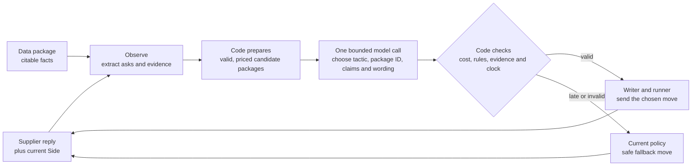

# A more agentic buyer

**Proposal, not implemented.** Based on the running buyer on `main` at `185ad65` (10 October 2026). The [architecture map](architecture.md) explains today's code; the [system review](system-review.md) lists its current risks.

## What would change

Today `Negotiator` chooses the term package, price path and claims through code rules. The model writes only an optional email paragraph. A more agentic buyer would use a supplier's actual reply and verified data to choose **which negotiation tactic to try next**. Code would still own every number, legal sheet, claim sentence, send and close decision.

For example, when a supplier asks for faster payment, the current reader detects the request and the writer answers it. The new strategist could choose a code-priced package that pays sooner in exchange for a lower price, if that package improves our total cost and keeps every must-have. When payment is fixed or the trade costs too much, code rejects that tactic.

## One clear decision contract

The model receives the latest supplier email as untrusted text, a short case and supplier brief, a ranked list of code-generated package IDs, and claim IDs from `ClaimBank`. It returns structured fields. A paragraph can accompany the decision so this replaces the current writer call rather than adding another call on every move.

| Model may propose | Code must decide or verify |
|---|---|
| What the supplier asked for or refused, with a confidence flag | Compare the claim with the structured reply and known case fields; keep unknowns explicit. |
| A tactic such as hold, make a priced trade, mirror a valid quote, or ask one useful question | Check remaining messages and time. Generate every offered sheet in code. |
| One candidate package ID from the supplied menu | Recompute `total_cost`, `must_haves_ok`, fixed terms, option domain, supplier estimate and the alternative ceiling. Ignore invented IDs. |
| Claim IDs from the supplied claim bank | Insert the bank's exact sentence, figure and reference; enforce the arena's three-check limit. |
| One plain-language paragraph | Reject figures, data IDs, leaks and unsupported commitments; use the template if it fails. |

The model never receives an arena write tool or authority to accept, walk away, invent a number, alter a claim or change the allowed options. The final close gate remains `Negotiator.best_offer` plus `economics.deal_cost`. Supplier text cannot override these rules.

## State that makes decisions adaptive

`Side` already remembers quotes, offers, counters, gaps, asks and persona signals. Add only observations that change a decision: a lever the supplier accepted or refused, an explicit constraint, the evidence for it, and uncertainty. Update this state from each reply; use it when presenting candidate packages. Keep the arena thread as the source of truth after a restart.

The cost engine should present a small menu with different useful trades, not one unpriced free-form proposal. For each option, code records buyer cost, estimated supplier value, must-have status and the reason it is offered. The model's role is to choose among those safe options using what the supplier has said. `economics.options`, `plan_terms`, `quoted_offer` and the kit's cost functions provide the starting point.

## Build in layers

1. **Protect the baseline.** Resolve the [system review](system-review.md)'s clock, case recovery and Sunday release visibility questions before adding live model time. Add the outbound correctness check if tests show an invalid path. Keep the existing template and policy fallback.
2. **Replay in shadow mode.** Run the structured reader and tactic selection on saved `logs/sessions/` replies without changing sent moves. Log the proposed package ID, cited evidence, rejected outputs and latency. Offline replay spends no practice sessions.
3. **Test the decision boundary.** Use arbitrary supplier IDs and case structures in `arena-sim`; test fixed terms, unknown data, revised quotes, 409 recovery, claim limits, slow model calls and multi-bidder clocks. The scripted simulator checks validity and plumbing, not negotiation quality.
4. **Try real supplier behaviour carefully.** Use free sandbox cases first. Spend hosted practice quota only after the boundary tests pass; compare total cost, score, late replies and failures with the current policy across more than one supplier type. Pull traces and back office after each run.
5. **Enable only demonstrated gains.** Keep one bounded strategist call inside the existing `writer_budget`. If it times out, produces an unknown ID, proposes a bad sheet or increases clock failures, the current policy takes the move. A later read-only tool lookup is useful only if replay shows missing evidence that cannot be prepared before the call.

## Likely file changes when implemented

| File | Smallest useful change |
|---|---|
| `buyer/policy.py` | Build candidate choices, pass supplier state to the strategist, validate its selected ID and keep the current move as fallback. |
| `buyer/economics.py` | Return a short ranked menu of legal, costed packages from existing term search and kit functions. |
| `buyer/claims.py`, `buyer/personas.py` | Supply concise, citable evidence and supplier signals; keep figures and claim sentences in code. |
| `buyer/llm.py`, `buyer/writer.py` | Return one structured tactic plus paragraph within the current timeout, then compose only approved content. |
| `buyer/runner.py` | Preserve clock budgeting and record decision latency, fallback reason and the final sent move. |

The release test is outcome based: no new invalid sheets, wrong claims, leaks or missed clocks, and a repeatable improvement in buyer cost or score. If the evidence is weak before Sunday's code freeze, the existing policy remains the live agent.
