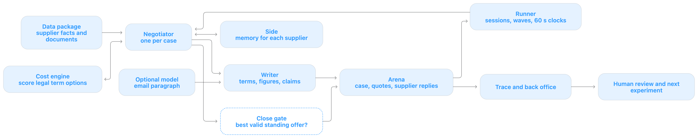

# Buyer architecture: the running system

Checked against `main` at `185ad65` on 10 October 2026. This page explains the implemented buyer. [Design](design.md) describes planned work; [learnings](learnings.md) records what practice showed; [system review](system-review.md) lists risks to investigate.

The buyer tries to minimize total cost over the case horizon. Unit price is only one part of that cost: uncovered demand, payment, freight, delivery, quality, tooling, index clauses and sometimes supplier relationship cost also matter. The final action is one accepted term sheet or a walk-away.

## System map

The supplied diagram shows the live negotiation and what happens after it. The runner owns the session and clocks; the negotiator owns decisions for one case. The model can help write a paragraph, while code sets the offer and closing action.

## Example: one supplier quote

This is an **illustrative routine case**, not a recorded session. Suppose we need 1,000 units, the supplier quotes €100 per unit, the buyer's alternative costs €110,000, and the selected non-price terms stay the same as the quote. The supplier has no special signals that change the usual price path.

1. **Arena → Runner.** The arena opens the case with the supplier's email and quote. The runner fetches the quote, starts one `Negotiator` for the case, and watches the supplier's 60 second reply clock.
2. **Data package → Side → Cost engine.** The negotiator reads supplier facts and quote terms. Its `Side` remembers this supplier's quote, profile and planned terms. The cost engine checks the allowed options and must-haves. In this simple example, the routine opening anchor is 82% of the comparable €100 quote, so the first sheet offers **€82 per unit**.
3. **Writer → Arena.** Code puts €82 and the complete term sheet in the email, plus up to three verified claim sentences if the data supports them. The optional model may write a short paragraph; it cannot change the sheet or figures. The runner sends the message to the arena.
4. **Supplier reply → Negotiator.** Suppose the supplier counters at **€95** with the same terms. `Side` records that counter. With no special rule triggered, the policy moves 30% of the €13 gap from our €82 offer toward €95: **€85.90**. The writer sends this next sheet, with at most one new claim.
5. **Close gate → Arena.** Suppose the supplier later makes **€90** its standing final sheet. The buyer does not accept on price alone. If `total_cost` values that complete sheet at €98,000, it meets every must-have, and the alternative is €110,000, the close gate accepts it. If no standing sheet passes those checks, it walks away. With several suppliers, it chooses the cheapest valid standing sheet across them.
6. **Trace → Human review.** The runner saves its decision notes; `buyer pull` collects the arena trace and official cost breakdown. The team compares the result with the best possible cost and tests the next change offline or in the sandbox.

The runner sends one message at a time within a case and serves the supplier whose reply has waited longest. Cases run in parallel during a wave. It limits the optional model to 15 seconds, stops negotiating 90 seconds before a final wave cap, and rereads arena state after a send or close returns HTTP 409.

## What each box does

| Box | Plain-language role | Where it lives |
|---|---|---|
| **Arena** | Supplies the case, opening quotes, supplier replies and final result. The kit handles API calls, session state and quote attachments. | `arena_kit.client`, `arena_kit.play`, [API brief](api.md) |
| **Runner** | Opens cases, chooses which supplier needs a reply, sends one message at a time within a case, watches clocks and runs final waves in parallel. | [`buyer/runner.py`](../buyer/runner.py), [`buyer/cli.py`](../buyer/cli.py) |
| **Data package** | Read-only supplier records, citable facts and documents. The Sunday release joins ID lookup; the package's SQL database stays separate. | `arena_kit.data.DataPackage`, [`buyer/claims.py`](../buyer/claims.py), [`buyer/personas.py`](../buyer/personas.py) |
| **Negotiator** | Owns one case's policy: sets up suppliers, reads replies, plans offers, selects claims and chooses the close action. | `Negotiator` in [`buyer/policy.py`](../buyer/policy.py) |
| **Side** | Remembers one supplier's quote, standard terms, profile, planned terms, offers, counters, asks and pending message. | `Side` in [`buyer/policy.py`](../buyer/policy.py) |
| **Cost engine** | Uses the kit's published cost function, estimates supplier value, searches allowed term combinations and rejects unacceptable deals. | [`buyer/economics.py`](../buyer/economics.py), `arena_kit.cost` |
| **Optional model** | Writes one middle paragraph in the email. It does not choose prices, terms, claims or accept actions. | [`buyer/llm.py`](../buyer/llm.py) |
| **Writer** | Assembles the code-chosen proposal, figures and cited claims into an email; prepares the model brief and template fallback. | [`buyer/writer.py`](../buyer/writer.py), `Negotiator.send` |
| **Close gate** | Finds the cheapest acceptable *standing* supplier sheet or walks away. It checks must-haves and estimated cost against the alternative. | `Negotiator.best_offer`, `Negotiator.close`, `economics.deal_cost` |
| **Trace and back office** | Hold the arena's full conversation, result and official cost breakdown after a session. | `buyer pull` in [`buyer/cli.py`](../buyer/cli.py) |
| **Human review** | Compares decisions with the result, records a finding, changes code and tests again. This is outside the live agent. | [`learnings.md`](learnings.md), [`analysis/explore.py`](../analysis/explore.py) |

### What is binding

The kit's `complete_offer` fills normal planned sheets to the case's negotiable fields. When mirroring a supplier alternative, `economics.quoted_offer` preserves its exact effective package instead of snapping its values. At close, `economics.deal_cost` requires a price, `must_haves_ok` and cost below the buyer's alternative. Its cost uses `arena_kit.total_cost` with this buyer's supplier estimate, so an unknown full cost can make the relationship charge uncertain.

Only the first supplier sheet in its latest reply is a standing sheet that can be accepted. A better alternative sheet must first be sent back so the supplier makes it standing. The model's paragraph is nonbinding, but its wording still matters; [system review](system-review.md) covers the missing central outbound check.

## Every Python file in `buyer/`

| File | Responsibility and main interfaces |
|---|---|
| [`__init__.py`](../buyer/__init__.py) | Marks `buyer` as the package. It contains only a package docstring and makes no decisions. |
| [`cli.py`](../buyer/cli.py) | Command entry point. `main` parses `play`, `run` and `pull`; `load_package` builds the shared ID index; `pull` saves completed sessions, traces and back office. It also selects the kit's naive baseline when requested. |
| [`runner.py`](../buyer/runner.py) | Live orchestration. `play_case` schedules supplier turns and sends messages; `writer_budget` protects clocks; `close` retries a refused close; `play_all` runs practice cases; `play_waves` polls and runs final waves; `save` writes run notes. |
| [`policy.py`](../buyer/policy.py) | The negotiation state machine. `Side` stores one supplier's state; `Negotiator.setup` builds its plan, `move` responds to a reply, `next_price` paces concessions, `pick` chooses claims, `send` assembles a move, `commit` and `rollback` track delivery, and `best_offer` and `close` choose the final action. `asks` reads fixed-form email requests. |
| [`economics.py`](../buyer/economics.py) | All cost and term math. `cost` wraps the kit's total cost; `estimate` models supplier economics; `plan_terms` scores allowed packages; `value` and `price_for_value` compare packages at equal supplier value; `quoted_offer` validates an exact supplier package; `relationship_optimum` handles cases where a lower price raises relationship cost; `deal_cost` is the accept gate. |
| [`claims.py`](../buyer/claims.py) | The citable argument bank. `ClaimBank` looks up facts and IDs, builds sentences about should-cost, orders, indexes, forecasts, notice, supplier notes, scorecards and rival quotes, then ranks them through `for_supplier`. `rival_offer` cites another bidder's current standing sheet. |
| [`personas.py`](../buyer/personas.py) | Supplier reading. `supplier_texts` gathers notes, letters, news and quote remarks; `signals_in` detects traits such as cash need or full capacity; `profile` derives owner, country, signals, cost of money and email tone. Unknown suppliers get a neutral profile. |
| [`writer.py`](../buyer/writer.py) | Email composition. `describe` names the code-chosen terms; `statements` writes binding volume or fixed-payment answers; `facts` and `brief` constrain what the model may say; `email` combines paragraph, claims and proposal; `keepalive_message` handles a waiting bidder. |
| [`llm.py`](../buyer/llm.py) | Optional model connection. `complete_from_env` builds the chat-completions caller; `paragraph` enforces a 15 second wall-clock ceiling and drops output with digits, IDs or leak phrases. The template works when no model is configured or the call fails. |

The buyer wraps `arena_kit`; it does not patch it. [`design.md`](design.md) separates planned agent components from this implemented path. [`system-review.md`](system-review.md) records the failure paths and improvement order. [A more agentic buyer](agentic-approach.md) proposes one bounded next step.
