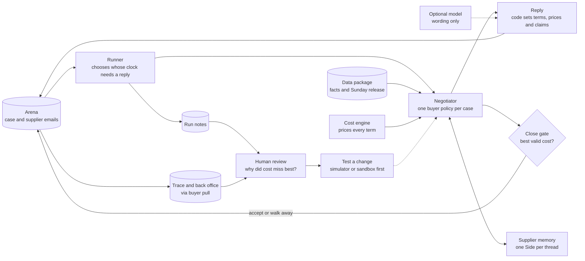
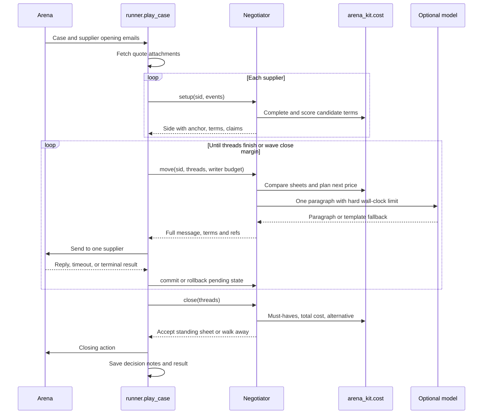
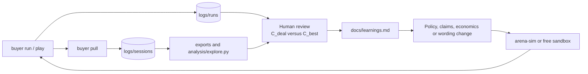

# Architecture review: the running buyer

Snapshot: `julian/second-branch` at `3c02621` on 10 October 2026. This describes the code that runs today. [Agent design](design.md) records the intended build, and [learnings](learnings.md) records observed supplier behaviour. The [claims team's architecture](https://github.com/stegra05/ehl-claimscabana/blob/main/docs/architecture.md) inspired the live path, module inventory and learning-loop layout.

The objective is the lowest total buyer cost over the case horizon, with the published score based on savings from opening cost toward best cost. Cost includes price, uncovered need, payment, freight, delivery, quality, tooling, index risk and sometimes a relationship charge. A broken must-have scores zero. The arena's message and wave clocks are part of the system design.

## 1. System map

Read the live loop left to right. The runner keeps the clocks, the negotiator decides what to offer, and the optional model helps phrase the email. After closing, a person uses the trace to decide what to test next.

The production path has one buyer policy, not a swarm of model agents. `Negotiator` owns a `Side` for each supplier thread. The model writes an optional paragraph; code chooses every term sheet, claim, accept and walk-away action. `--agent naive` selects the kit's separate baseline through the CLI. `arena_kit` handles the API, quote parsing and exact cost function under these boxes.

## 2. Entry points and lifecycle

| Entry point | When it runs | Main path |
|---|---|---|
| `buyer play case:D01` | One sandbox or practice case | `cli.main` → `runner.play_case` → `RemoteTable` |
| `buyer run --set practice` | Parallel hosted practice cases | `cli.main` → `runner.play_all` → one `play_case` per case |
| `buyer run --set final` | Five live waves | `cli.main` → `runner.play_waves` → one `play_case` per open case |
| `buyer pull` | After sessions end | `cli.pull` reads session, trace and back office into `logs/sessions/` |
| `analysis/explore.py` | Offline | Queries the package and produces `analysis/out/` |
| Tests | Offline, no hosted quota | `arena-sim` and fake tables exercise the runner and policy |

`cli.main` loads `.env`, constructs one `ArenaClient`, opens one `DataPackage` and builds its ID index before cases run in parallel. The optional model client is built once. Each case gets its own `RemoteTable` and `Negotiator`; the package and client are shared.

The final loop polls the case list, records each wave's cap from `seconds_left`, and submits open cases to a thread pool. A failed poll is retried. A case exception causes one restart using the kit's session resume path. The loop ends after the requested number of waves have closed and all started cases have finished.

## 3. One case on the clock

The arena serializes calls within a session. `runner.play_case` therefore chooses the live thread with the oldest supplier reply, with quote price as the first-round tie-breaker. A finished bidder may receive a keepalive question while another is still negotiating. `writer_budget` caps model time at 15 seconds and reserves time for other live thread clocks. `deadline_near` starts closing 90 seconds before a wave cap.

A 409 on a send causes `rollback` and a fresh arena read through `RemoteTable.missed`. A 409 on close causes a fresh read and a new guarded close decision, up to three tries. A terminal result returned by a send ends the case without another close request.

## 4. Module and function inventory

| Module | Main functions or methods | Responsibility |
|---|---|---|
| [`buyer/cli.py`](../buyer/cli.py) | `main`, `pull` | Parse commands, choose buyer or naive agent, save completed session data. |
| [`buyer/agent.py`](../buyer/agent.py) | `load_package`, `naive_factory` | Build the shared read-only package index; expose the kit baseline. |
| [`buyer/runner.py`](../buyer/runner.py) | `writer_budget`, `play_case`, `close`, `save`, `play_all`, `play_waves` | Schedule cases and supplier messages, enforce clock margins, contain failures and write run notes. |
| [`buyer/policy.py`](../buyer/policy.py) | `Side`; `Negotiator.setup`, `restore`, `trade_clause`, `adopt`, `move`, `next_price`, `finish`, `pick`, `send`, `fallback_move`, `commit`, `rollback`, `best_offer`, `close` | Keep per-supplier state; choose prices, terms, claims and closing action. |
| [`buyer/economics.py`](../buyer/economics.py) | `cost`, `c_alt`, `deal_cost`, `estimate`, `clause_trade`, `value`, `price_for_value`, `options`, `plan_terms`, `relationship_optimum` | Wrap the kit's cost and supplier-value functions, search allowed terms and enforce the accept gate. |
| [`buyer/claims.py`](../buyer/claims.py) | `ClaimBank.fact`, `ids`, `query`, `for_supplier`, claim builders; `rival_offer` | Build ranked, data-backed sentences and their citable IDs. |
| [`buyer/personas.py`](../buyer/personas.py) | `signals_in`, `supplier_texts`, `profile` | Read owner and cash signals from package text, quotes and supplier emails. |
| [`buyer/reader.py`](../buyer/reader.py) | `asks` | Extract volume, proof, payment and price-target questions by regex. |
| [`buyer/writer.py`](../buyer/writer.py) | `describe`, `email`, `brief`, `keepalive` | Render computed terms and claims into supplier emails and prepare the model brief. |
| [`buyer/llm.py`](../buyer/llm.py) | `complete_from_env`, `paragraph` | Call the optional model with a 15 second ceiling; reject digits, IDs and leak phrases. |
| [`analysis/explore.py`](../analysis/explore.py) | `supplier_profiles`, `price_fairness`, `triggers`, `negotiation_events`, `main` | Offline data exploration, outside live negotiation. |

The kit supplies `ArenaClient`, `RemoteTable`, document parsing, `standing`, `moves_left`, `complete_offer`, `closing_terms`, `supplier_value`, `total_cost` and `must_haves_ok`. This repo wraps those functions; it does not patch the kit. The dependency is pinned in [`pyproject.toml`](../pyproject.toml).

## 5. Decision path inside `Negotiator`

1. **Setup.** Read each supplier's standing quote and standard terms from its attachments. Build a persona, estimate its cost of money and, when supported, full cost and defect rate. Pick an anchor by category goal and observed signals. `plan_terms` evaluates allowed non-price combinations at equal estimated supplier value, then chooses the lowest buyer cost.
2. **Read.** On each new reply, inspect structured term sheets, extract fixed-form asks and merge new persona signals. `adopt` may take terms the supplier proposed when the whole sheet improves buyer cost and keeps must-haves.
3. **Price.** `next_price` starts at the anchor, then moves a share of the gap toward the supplier's counter. A deep first concession can hold the price low. A smaller patience budget limits gaps for near-cost, full-capacity and relationship cases.
4. **Argue.** `ClaimBank` ranks should-cost, orders, index movements, notice, forecast, scorecard and rival quotes. `pick` sends at most three claims first, then one per later round, and does not reuse a spent ID in the case.
5. **Write.** Code creates the sheet, binding volume statement and cited claim sentences. The optional model sees the last email, supplier traits and approved plain-language facts. `llm.paragraph` drops a late, empty, long or forbidden output; `writer.email` uses a template instead.
6. **Finish.** A final offer, agreement or round limit ends price moves. A cheaper alternative sheet can be mirrored to make it standing. `close` considers only standing sheets, checks must-haves and compares estimated total cost with the alternative. Otherwise it walks away.

For an index clause, `trade_clause` can offer one up front if the estimated supplier benefit exceeds buyer cost. `adopt` can later take the supplier's required clause when its new sheet costs less than its previous one. For relationship goals, `relationship_optimum` stops pushing below the price where estimated total cost is lowest.

## 6. Data and contracts

| Boundary | Shape and source | Used by |
|---|---|---|
| Case | Arena case object: buyer need, horizon, alternative, fixed terms, negotiable fields, options, must-haves, refs and facts | `Negotiator`, `economics`, `ClaimBank` |
| Supplier thread | Ordered messages with `from`, `status`, `body`, attachments and up to three term sheets | `runner`, `reader`, `standing` |
| Standing sheet | First supplier sheet in its latest reply, with `term_sheet_id` | `best_offer`, accept action |
| Outgoing move | `subject`, `body`, `term_sheets: [{"terms": ...}]`, `refs`, optional attachments | `RemoteTable.send` |
| Closing action | `accept` with a standing sheet ID, or `walk_away` | `RemoteTable.close` |
| Package | SQLite, `facts.json`, citable ID index and documents; optional Sunday release merged by `DataPackage` | Personas, claims, cost estimate |
| Run log | Per-move notes and final result in `logs/runs/` | Human review |
| Session pull | Full trace and back office in `logs/sessions/` | Learning and offline analysis |

Every outgoing sheet is completed to the case's `negotiable` fields by the kit's `complete_offer`. Unstated closing fields are priced using the supplier's standard terms from its quote. The accept gate is `deal_cost`: a positive price, `must_haves_ok`, and cost below the alternative. The cost uses the kit's exact published `total_cost` formula with this agent's supplier estimate for the relationship charge.

`DataPackage` includes Sunday's `facts.json` and release CSV rows in ID lookup. Its SQL connection remains the Saturday package database. That split matters for the review below.

## 7. Failure containment and observability

- The model is optional. A missing key, timeout, exception or rejected paragraph leaves a template email and the numeric move intact.
- `Negotiator.safe` isolates several missing-data calculations during setup; `runner.play_case` catches supplier setup and move failures so another bidder can continue. A failed move resends the last sheet or asks a short question.
- Per-case exceptions do not stop the other cases in `play_all` or `play_waves`; final cases get one resume attempt.
- `runner.save` records setup, term changes, claims selected, prices, asks, rollbacks, accept decisions and the result. `buyer pull` collects the fuller arena trace and back office after a session.
- Tests cover the accept gate, relationship charge, index adoption, 409 close recovery, terminal sends, model wall-clock limit, wave polling and every available case structure in the local simulator. The simulator's scripted supplier checks integration, not negotiation quality.

## 8. Learning loop and document boundaries

The runtime does not retrain itself or call a second planning model. The planned stance call, model reader and supplier fact-check stage in [`design.md`](design.md) are not implemented in this snapshot. [`system-review.md`](system-review.md) records the current strengths, limits and proposed review order.
